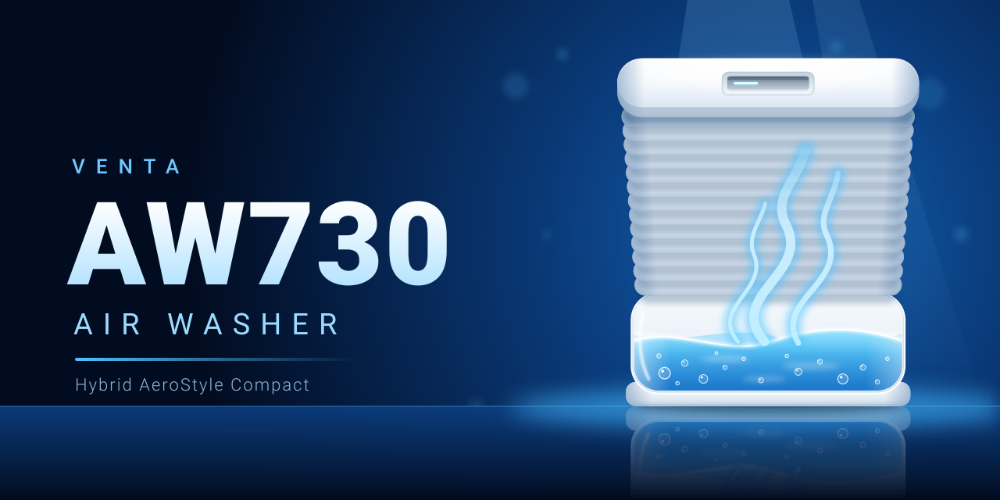

<p align="center">
  
</p>

# Venta AW730

[](https://github.com/dmitriy1ebedev/venta-aw730-homeassistant/actions/workflows/validate.yml)
[](https://github.com/dmitriy1ebedev/venta-aw730-homeassistant)
[](https://www.home-assistant.io/)
[](https://www.home-assistant.io/integrations/homekit/)
[](https://docs.yaha-cloud.ru/)
[](https://github.com/xZetsubou/hass-localtuya)
[](README.ru.md)
[](LICENSE)

[English](README.md) · [Русский](README.ru.md)

Connect the **Venta AW730 AeroStyle Compact** air washer to [Home Assistant](https://www.home-assistant.io/), [Apple Home / Siri](https://www.home-assistant.io/integrations/homekit/), and [Yandex Alice](https://docs.yaha-cloud.ru/). The complete Venta LocalTuya template **is bundled with this repository**; no separate template download is required.

## Features

Power, target humidity 30–70%, Auto / Manual / Sleep, five fan speeds, LED controls and sensors. A **single Apple Home accessory** with **Auto / Humidify / Off**.

## Installation

**1. Install [LocalTuya](https://github.com/xZetsubou/hass-localtuya).** The connection uses Tuya LAN protocol 3.4 and your own Smart Life / Tuya device credentials.

**2. Install Venta AW730 from Marketplace.**

<!-- ha-marketplace:exclude-start -->
[](https://my.home-assistant.io/redirect/hacs_repository/?owner=dmitriy1ebedev&repository=venta-aw730-homeassistant&category=integration)
<!-- ha-marketplace:exclude-end -->

The ready-made [`venta_aw730.yaml` template](custom_components/venta_homekit_native/templates/venta_aw730.yaml) is included in this integration. To register it in the LocalTuya template chooser, run **once in your Home Assistant terminal**:

```bash
python3 /config/custom_components/venta_homekit_native/install_localtuya_template.py
```

For Home Assistant Container, run the command using `docker exec homeassistant ...` from the host. Then add the Venta device in LocalTuya and select `venta_aw730.yaml`. The installer does not overwrite an existing modified template unless `--replace` is specified, in which case it makes a backup.

**Apple Home:** configure an existing [HomeKit Bridge](https://www.home-assistant.io/integrations/homekit/), add the [configuration example](examples/configuration.yaml.example) to `configuration.yaml` with your entity IDs, validate and restart HA. Do not recreate your working Venta accessory or pairing.

**Alice:** expose the same humidifier entity with [Yaha Cloud](https://docs.yaha-cloud.ru/) ([source](https://github.com/dext0r/yandex_smart_home)).

## Compatibility

Venta AW730, Tuya 3.4, Home Assistant 2026.11. The extension depends on internal HomeKit APIs and may need updates after major HA releases.

## License

MIT © Dmitriy Lebedev. Tuya mappings adapted from [Shinz2711](https://github.com/Shinz2711/venta-aw730-localtuya) (MIT; [attribution](THIRD_PARTY_NOTICES.md)).

Project: [Contributing](CONTRIBUTING.md) · [Security](SECURITY.md) · [Code of conduct](CODE_OF_CONDUCT.md)
