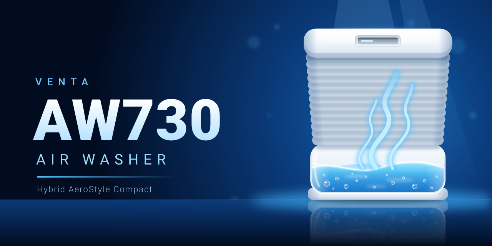

  

# Venta AW730

[Русский](README.ru.md) · [English](README.md)

Подключение мойки воздуха **Venta AW730 AeroStyle Compact** к [Home Assistant](https://www.home-assistant.io/), [Apple Home / Siri](https://www.home-assistant.io/integrations/homekit/) и [Алисе](https://docs.yaha-cloud.ru/). **Весь шаблон Venta уже в этом репозитории** — отдельно скачивать шаблон с другого GitHub не нужно.

## Что умеет

Питание, влажность 30–70%, режимы Авто / Ручной / Сон, пять скоростей вентилятора, подсветка и датчики. В Apple Home — одно устройство с переключателем **«Авто / Увлажнение / Выкл.»**.

## Установка

**1. Установите [LocalTuya](https://github.com/xZetsubou/hass-localtuya).** Он подключает мойку локально по протоколу Tuya 3.4. Для добавления устройства потребуются ваши данные подключения из Smart Life / Tuya.

**2. Установите Venta AW730 через Marketplace.**

<!-- ha-marketplace:exclude-start -->

<!-- ha-marketplace:exclude-end -->

Шаблон [`venta_aw730.yaml`](custom_components/venta_homekit_native/templates/venta_aw730.yaml) уже в комплекте. После настройки Venta и запуска Home Assistant он автоматически появляется в LocalTuya. Добавьте устройство и выберите этот шаблон — скачивать его отдельно не нужно.

Если вы добавляете устройство **до** настройки расширения Venta для HomeKit, один раз зарегистрируйте шаблон командой `python3 /config/custom_components/venta_homekit_native/install_localtuya_template.py` в терминале Home Assistant (для Container — через `docker exec`).

**Обновления:** после установки новой версии Venta через Marketplace и перезапуска Home Assistant неизменённый шаблон LocalTuya синхронизируется автоматически, прежняя копия сохраняется. Пользовательский шаблон не перезаписывается. Конфигурации ранее добавленных устройств хранятся в LocalTuya отдельно; изменения их сопоставлений требуют проверки. Учётные данные и идентификаторы сущностей автоматически не переписываются. Apple Home и Алиса используют **ту же существующую сущность увлажнителя**, без второго устройства.

**Apple Home:** используйте существующий [HomeKit Bridge](https://www.home-assistant.io/integrations/homekit/) и добавьте [короткую настройку](examples/configuration.yaml.example) в `configuration.yaml`, заменив примеры идентификаторов своими. Проверьте конфигурацию и перезапустите Home Assistant. Уже подключённую Venta и сопряжение HomeKit удалять не нужно.

**Алиса:** экспортируйте ту же сущность увлажнителя через [Yaha Cloud](https://docs.yaha-cloud.ru/) ([исходники](https://github.com/dext0r/yandex_smart_home)).

## Совместимость

Проверена одна Venta AW730 Smart Life/Tuya 3.4 с LocalTuya 2026.10.0 и Home Assistant 2026.11.1. Другие модели и версии HA пока не подтверждены. См. [матрицу совместимости и диагностику](docs/compatibility.md). Расширение HomeKit зависит от внутренних API Home Assistant; после крупных обновлений может понадобиться адаптация.

## Лицензия

MIT © Dmitriy Lebedev. Сопоставления Tuya адаптированы из проекта [Shinz2711](https://github.com/Shinz2711/venta-aw730-localtuya) (MIT; [атрибуция](THIRD_PARTY_NOTICES.md)).

Проект: [Дорожная карта](ROADMAP.md) · [История изменений](CHANGELOG.md) · [Процедура выпуска](docs/RELEASING.md) · [Диагностика](docs/DIAGNOSTICS.md) · [Участие](CONTRIBUTING.md) · [Безопасность](SECURITY.md) · [Правила сообщества](CODE_OF_CONDUCT.md)
